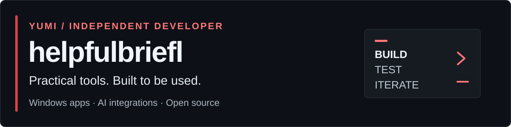

<a href="https://helpfulbriefl.github.io/">
<picture>
  <source media="(max-width: 600px)" srcset="assets/profile-banner-mobile.svg">
  
</picture>
</a>

**[Portfolio](https://helpfulbriefl.github.io/)** · **[Download Folio](https://github.com/helpfulbriefl/folio/releases/latest)** · **[Telegram: @yumi_acess](https://t.me/yumi_acess)**

## Hi, I'm yumi

I'm a **self-taught, independent developer** building small tools I actually use. My focus is Windows desktop apps, practical AI integrations, and interactive web experiments.

I turn ideas into specifications, work through architecture and business logic, and iterate on working software. My workflow combines AI-assisted development with reproducible tests and practical iteration.

## Featured projects

### [Folio — a calm notepad with a powerful second side](https://github.com/helpfulbriefl/folio)

A Windows tray notepad for everyday writing, Markdown and AI chat reading, legacy encodings, and **reviewable AI edits with your own API key**.

- Tabs, session recovery and file version history.
- Reader, coding and proofreading modes.
- Multiple OpenAI-compatible API profiles, model selection and streaming responses.
- Global quick notes, themes, and English / Russian / Chinese interfaces.
- C# · .NET 8 · WinForms · WebView2 · JavaScript · CodeMirror.

[**Download the Windows app →**](https://github.com/helpfulbriefl/folio/releases/latest) · [Source & build instructions](https://github.com/helpfulbriefl/folio)

### [Keeper's Corner Aquarium](https://github.com/helpfulbriefl/keepers-corner-aquarium)

An experimental interactive 3D aquarium built with JavaScript and Three.js—a playful exploration of browser-based 3D.

[**Try the live demo →**](https://helpfulbriefl.github.io/keepers-corner-aquarium/) · [Source](https://github.com/helpfulbriefl/keepers-corner-aquarium)

## What I work on

| Area | Focus |
| --- | --- |
| Desktop development | C#, WinForms, Windows utilities and practical interfaces. |
| APIs & automation | Python, bots, web services and provider integrations. |
| Web experiments | JavaScript, HTML/CSS and interactive demos. |
| Product thinking | Specifications, architecture, business logic and integration planning. |
| Technical content | Clear demos, written walkthroughs, and visual/video content for products. |

### Building next

- **An extended Windows taskbar:** app shortcuts, icon organization and open-app management.
- **ApiBook:** a notebook for API providers, endpoints and key management.

These are projects in development, not released products. I'll add public repositories and demos when they're ready.

## Open to collaboration

I'm interested in **API-credit sponsorships and small, clearly scoped development or content collaborations**.

Useful ways we could work together:

- Test an OpenAI-compatible provider in a real desktop workflow and write reproducible compatibility reports.
- Build a focused integration or demo, with setup documentation people can actually follow.
- Create technical walkthroughs, screenshots or short product videos.
- Acknowledge agreed support transparently in relevant project documentation.

I work solo and can currently commit **around 8 hours per week** across development and collaboration. Let's agree on a realistic pilot, deliverables and usage budget first. Public-app access and my own development usage are separate questions; no shared sponsor key belongs in a public executable.

**Reach me:** [@yumi_acess on Telegram](https://t.me/yumi_acess) · [Portfolio](https://helpfulbriefl.github.io/)

## Live project signals

Build and release badges come from GitHub. Executable downloads are not unique or active-user counts.
